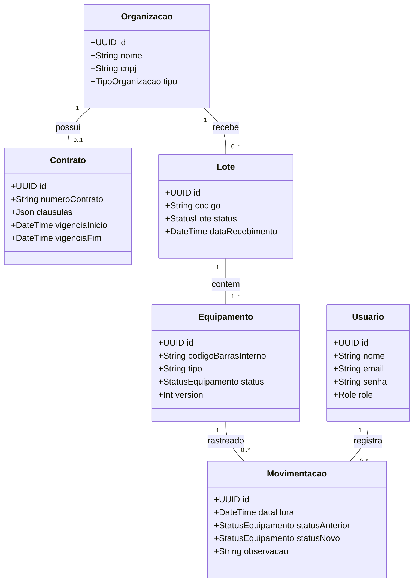
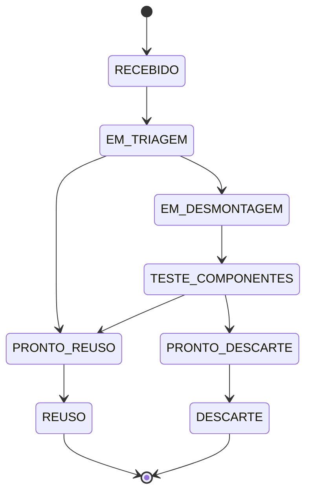

# Diagrama de Classes e Arquitetura - GreenCode API

Este documento apresenta o diagrama de classes e a máquina de estados dos equipamentos da GreenCode API, sistema voltado à gestão de logística reversa e rastreabilidade de resíduos eletrônicos.

## 1. Diagrama de Classes

## 2. Máquina de Estados Finita (FSM) dos Equipamentos

A máquina de estados representa as transições permitidas durante o ciclo de rastreabilidade dos equipamentos eletrônicos.

## 3. Observações

- O diagrama de classes apresenta os principais atributos e relacionamentos do domínio.
- A máquina de estados descreve o fluxo esperado para o processamento dos equipamentos.
- As transições devem respeitar as regras de negócio implementadas na API.
- Tentativas de transição para estados não permitidos devem ser rejeitadas conforme as validações da aplicação.
- O atributo `version` do equipamento está relacionado ao controle otimista de concorrência, quando implementado na camada de persistência.
