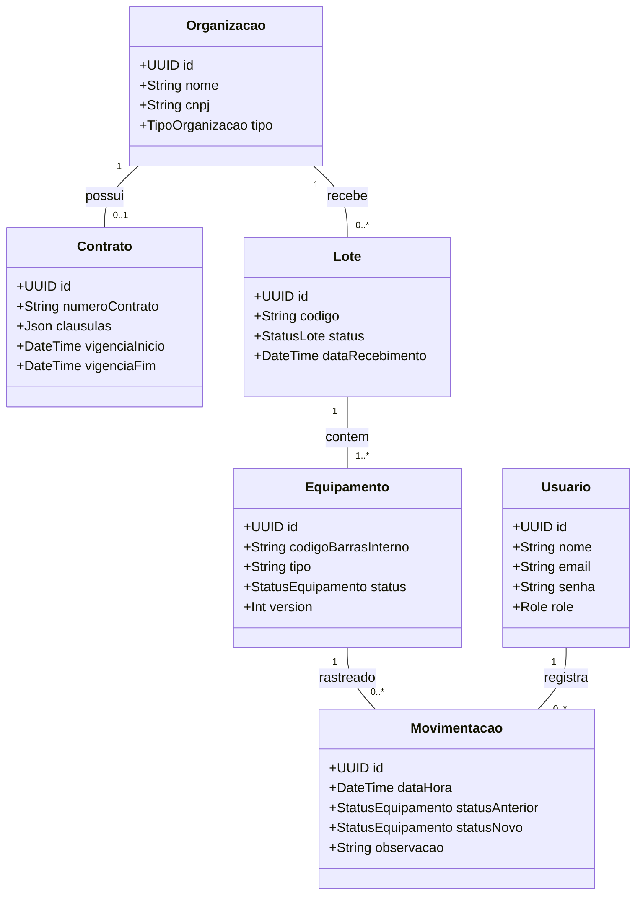
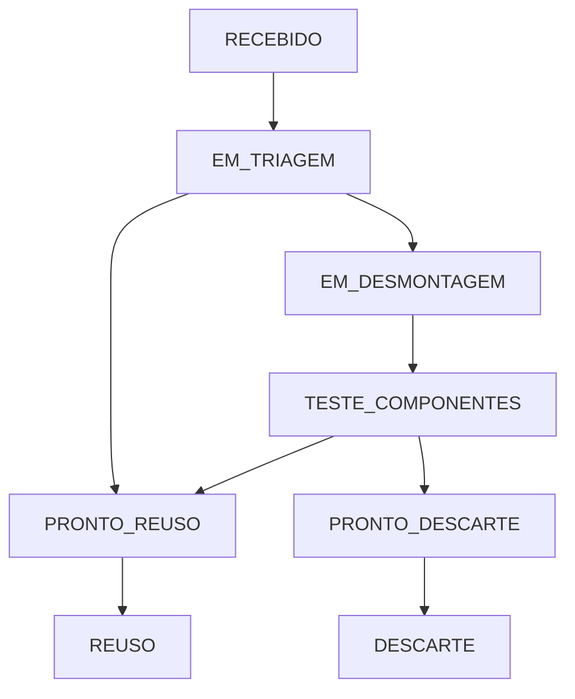

# Diagrama de Classes e Arquitetura - GreenCode API

## 1. Diagrama de Classes

## 2. Fluxo da Máquina de Estados Finita (FSM) dos Equipamentos

## 3. Regras da Máquina de Estados

- Os equipamentos devem seguir as transições de status permitidas pela máquina de estados.
- Transições inválidas devem ser rejeitadas pela API.
- O status do equipamento deve refletir seu estágio no processo de logística reversa.
- O histórico de movimentações registra as alterações de status para permitir a rastreabilidade.

